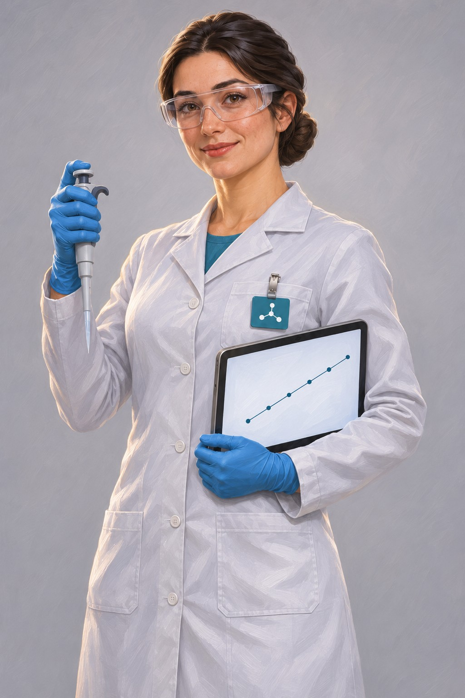
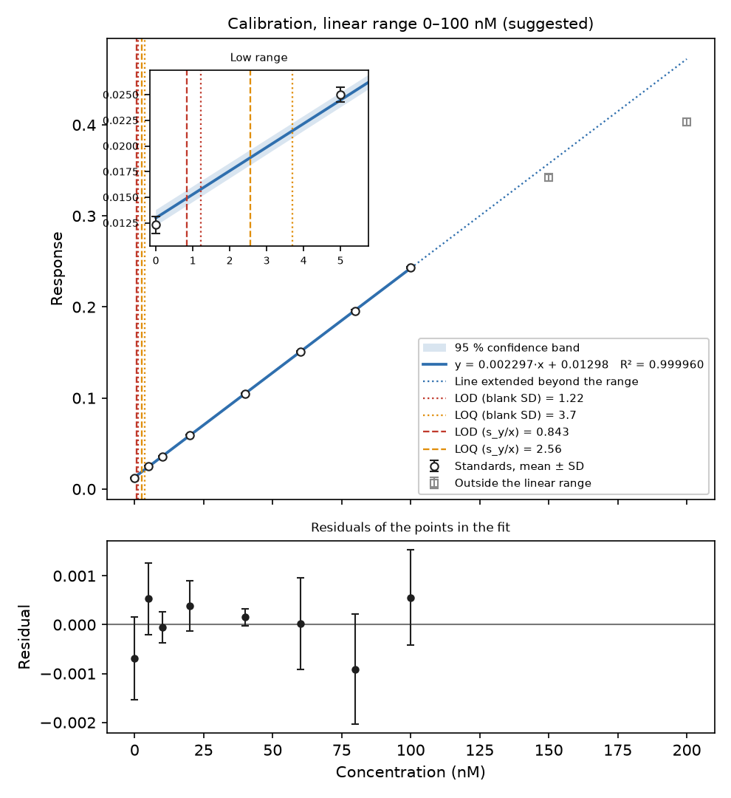

# Lina – Offline Lab Assistant

<p align="center">
  
</p>

A small project to run an AI lab assistant fully offline. Lina is a local language model in [LM Studio](https://lmstudio.ai) with the character of an analytical chemist. When I give her calibration data, she calls a Python tool that checks linearity and calculates the LOD and LOQ, and then she explains the results. Nothing leaves my computer.

## Why

I wanted to try a local AI for lab data without sending unpublished results to online services. Language models are not reliable with numbers, so here the model never calculates anything. The Python code does all the maths and draws the figure; the model only decides when to call it and explains the output. The model and the tool are connected through MCP (Model Context Protocol), which LM Studio supports.

## What it does

**Input:** calibration points as (X, Y, SD), meaning concentration, mean response and standard deviation. You can type them in the chat or save them as a CSV file in `data/`.

**Output:**
- the calibration line, the slope (sensitivity) and R²
- a linearity check (Mandel's test and a lack-of-fit test), with a suggested linear range if the curve bends
- the LOD and LOQ, calculated two ways: from the SD of the blank and from the scatter around the line
- a short report and a figure



*Example with synthetic data: the response bends above 100 nM, so the tool keeps 0–100 nM as the linear range.*

The maths is explained briefly in [docs/math_explained.md](docs/math_explained.md).

## Setup

See [docs/setup.md](docs/setup.md) (Windows, LM Studio, Gemma 4 12B).

The calculation also works without the AI:

```
python calibrate.py data/example_points.csv --n 3 --conc-unit nM
```

## Files

- `labassist/` – the calculation, report and figure
- `server.py` – connects the tool to LM Studio
- `calibrate.py` – command-line version
- `check_model.py` – optional test of how well the model uses the tool
- `prompts/` – Lina's system prompt
- `data/` – example data; your own files here are not uploaded to git
- `tests/` – automatic tests

## Notes

- The line statistics are checked against a worked example from Miller & Miller, *Statistics and Chemometrics for Analytical Chemistry*, and the rest by automatic tests.
- A 12B model can still make mistakes. LM Studio shows every tool call for approval, and the saved report is the reference.
- Lina's picture was made with ChatGPT ([prompt](visuals/lina_image_prompt.md)).

## 🧑‍💻 Author

Developed by: **Vu Bao Chau Nguyen, Ph.D.**

Keywords: local LLM, offline AI, LM Studio, Model Context Protocol (MCP), Gemma 4, analytical chemistry, calibration curve, linearity, limit of detection (LOD), limit of quantification (LOQ), electrochemical sensors, Python
