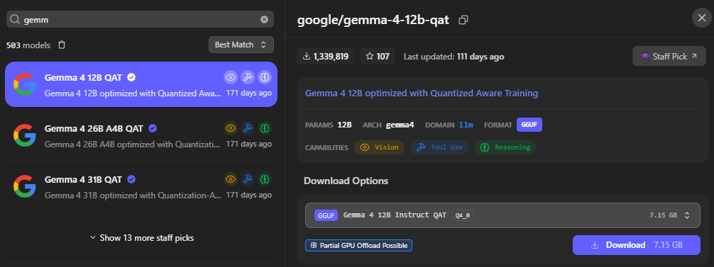
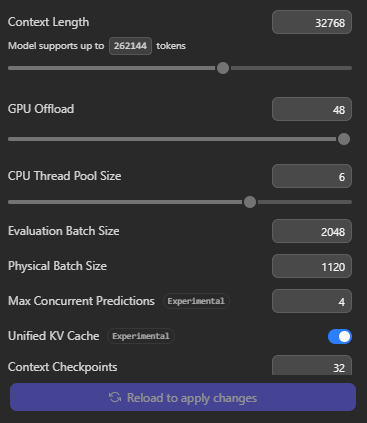
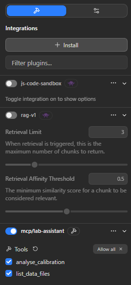
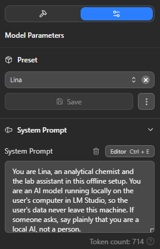

# Setup (Windows)

Tested with LM Studio 0.4.28 and Gemma 4 12B QAT on a laptop with 32 GB RAM and an NVIDIA GPU.

## 1. What you need

- [LM Studio](https://lmstudio.ai), version 0.4.10 or newer
- [Python](https://www.python.org/downloads/) 3.10 or newer (tick "Add python.exe to PATH" when installing)
- About 8 GB of free disk space for the model

## 2. Install the Python part

Download or clone this repository, for example to `C:\Users\YOUR-NAME\offline-lab-assistant`. Then open Command Prompt and run:

```
cd %USERPROFILE%\offline-lab-assistant
py -m venv .venv
.venv\Scripts\python -m pip install -r requirements.txt
.venv\Scripts\python -m pytest
```

The tests should end with `29 passed`.

## 3. Download the model

In LM Studio, open **Model Search**, type `gemma 4 12b`, choose **Gemma 4 12B QAT** from google (it should have the Tool Use label) and click **Download** (about 7 GB).



## 4. Load the model

Load the model from the selector at the top. In the load settings:

- **Context Length:** 8192 is enough.
- **GPU Offload:** as high as possible.



## 5. Connect the tool

1. In the right panel, open the hammer tab, click **Install**, then **Edit mcp.json**.
2. Paste this, change `YOUR-NAME` to your Windows user name, and save:

```json
{
  "mcpServers": {
    "lab-assistant": {
      "command": "C:/Users/YOUR-NAME/offline-lab-assistant/.venv/Scripts/python.exe",
      "args": ["C:/Users/YOUR-NAME/offline-lab-assistant/server.py"],
      "timeout": 120000
    }
  }
}
```

3. Switch on **mcp/lab-assistant**. Its two tools should appear. Keep them on "Ask" at first, so you see each call before it runs.



## 6. Add Lina

In the right panel, open the sliders tab. Paste the text from [prompts/lina_system_prompt.md](../prompts/lina_system_prompt.md) into **System Prompt**, and save it as a preset called "Lina".



## 7. Try it

Start a new chat with the Lina preset and type:

> Please analyse example_points.csv. Each point is the mean of 3 readings, concentrations in nM.

Approve the tool call. Lina should report the linear range 0–100 nM, the LODs and the paths to the report and figure (in the `results` folder).

You can also type points directly, for example `(0, 0.013, 0.0008), (20, 0.050, 0.0017), (40, 0.106, 0.0021) in nM`. Put your own CSV files (columns `concentration,response,sd`) in the `data` folder.

## Optional: test the model

`check_model.py` asks the model a few test questions and checks whether it calls the tool and copies the numbers correctly. Switch on **Model Server** in LM Studio, then run:

```
.venv\Scripts\python check_model.py
```

## Problems

- **Tools don't appear:** there's probably a typo or wrong path in mcp.json. Fix it and restart LM Studio.
- **The model answers without using the tool:** check that the Lina preset is active, and ask again: "Use the calibration tool."
- **The model is slow:** lower the context length and reload the model.
