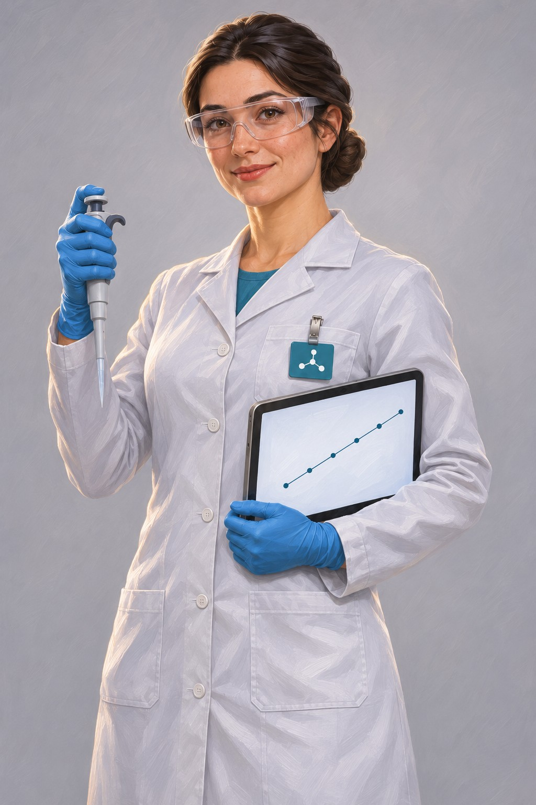

# Lina: character image



Lina is the character of this offline lab assistant: an analytical chemist in her early 30s. The image is an original illustration made with an AI image generator (ChatGPT) from the two prompts below. It is used only in this repository's documentation; the assistant itself runs as text in LM Studio.

## Step 1: base prompt

```
Create an image: a semi-realistic digital painting of an original character, Lina, a female analytical chemist in her early 30s.

COMPOSITION: Portrait orientation, 2:3 (1024x1536). Three-quarter body view, cropped at mid-thigh, centred, a little space above the head. Body turned slightly to the side, face toward the viewer.

EXPRESSION: Calm, confident and approachable; a slight warm smile; attentive eyes, like a colleague about to explain a result.

APPEARANCE: Dark hair neatly tied back in a low bun, a few loose strands. Clear wrap-around safety glasses worn over the eyes.

CLOTHING: Knee-length white lab coat, fully buttoned, sleeves down to the wrists. A teal-blue top visible at the collar. Blue nitrile gloves pulled over the coat cuffs. Small teal-blue ID badge clipped to the coat pocket, showing only a simple molecule icon (no text).

PROPS: Left arm holds a tablet against her body, screen angled toward the viewer, showing a clean calibration graph: a straight rising line with six dots on it, no text or numbers. Right hand holds a single-channel laboratory micropipette upright: plunger button on top, slim grey body, clear disposable tip pointing down.

STYLE: Semi-realistic digital painting, clean and polished, natural skin tones, detailed face and hands, soft professional studio lighting with a gentle rim light. Not photorealistic, not anime, not cartoon, not 3D render.

BACKGROUND: Plain light grey studio background with a soft gradient.

RULES: Original design that does not resemble any existing character or real person. No text, letters, logos or watermarks anywhere.
```

## Step 2: refinement (same chat)

```
Keep the same character, face, pose, clothing and composition, with these changes:
1. Render it as a slightly more illustrated digital painting, with soft visible brush strokes, so it clearly reads as an illustrated character, not a photograph.
2. She holds the micropipette the way scientists do: fingers wrapped around the body, thumb resting on the plunger button on top.
3. Tuck the loose hair strands neatly into the bun.
```

## Design notes

- **Illustrated, not photographic.** She is a fictional AI character, so she should never be mistaken for a real person.
- **Correct lab practice:** buttoned coat, safety glasses worn, hair tied back, nitrile gloves, and a correct micropipette grip.
- **Fixed props:** the tablet shows a straight calibration line with data points, which is the assistant's job (linearity and detection limits). The badge shows a molecule icon with no text.
- **Colours:** white, teal-blue and grey, on a plain background.
- **Reuse:** for any new pose or outfit, upload `lina.jpg` as the reference and say "same character".
